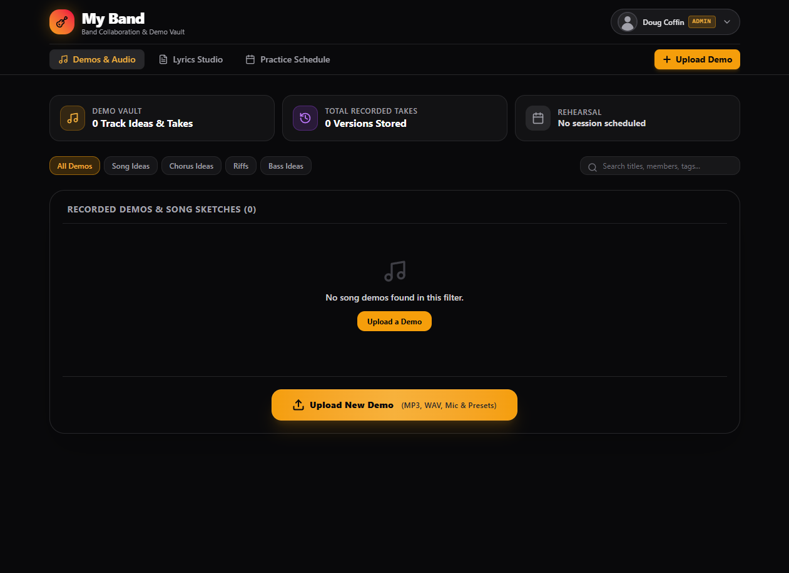
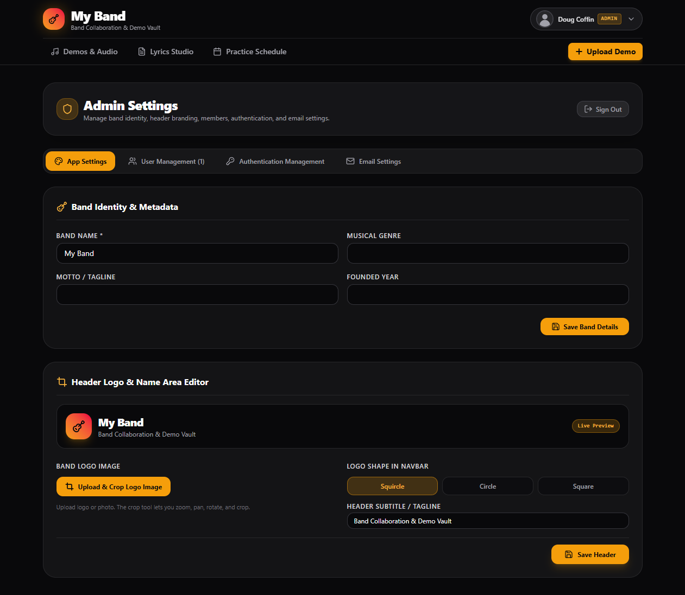
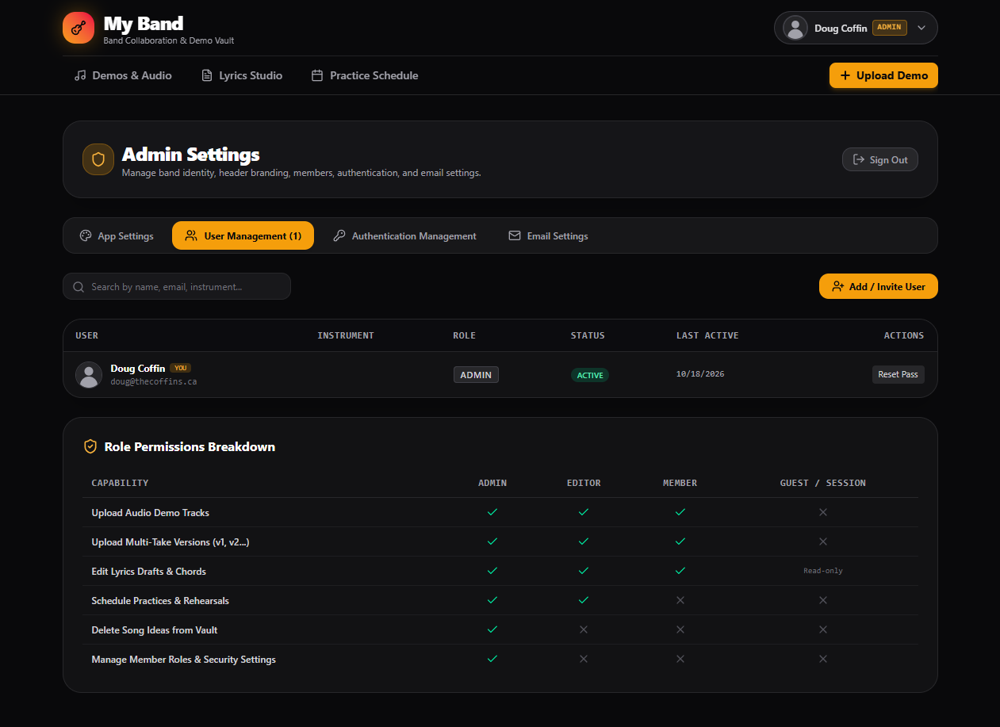

<div align="center">

<p><strong>Your band's home base</strong></p>
<p><sub>Recordings · Lyrics · Rehearsals · Collaboration</sub></p>
</div>

**A shared workspace for bands to manage audio recordings, lyrics, rehearsals, and members.**

RehearsalHQ provides a centralized, self-hosted environment for band collaboration, with role-based permissions, secure authentication, audio storage, and customizable user profiles.

## Features



- **Audio Management** - Upload, organize, and access recordings through an authenticated API.
- **Lyrics & Rehearsals** - Collaborate on lyrics and manage rehearsal activities.
- **Member Management** - Manage accounts, permissions, and invitations.
- **Multiple Bands** - Keep each band's recordings, schedules, settings, and memberships isolated; switch bands from the account menu.
- **Super Admins** - Create band instances and grant Super Admin access while Band Admins manage their own members.
- **Role-Based Access** - Super Admin, Band Admin, Band Member, and Band Guest permissions.
- **Personalized Appearance** - Individual theme preferences.
- **Email Notifications** - SMTP invitations, delivery tracking, and resend capabilities.
- **Docker Deployment** - Prebuilt production image with persistent bind mounts, health checks, and resource limits.

### Appearance & Branding

Each member can customize their appearance under **Profile & Settings → Appearance**.


Existing accounts inherit the previous shared appearance settings once during an upgrade.

Band-wide branding, including the logo, logo shape, name, and subtitle—is managed exclusively by Band Admins under **App Settings**.



---

## Getting Started

RehearsalHQ is distributed as a prebuilt Docker image for Linux AMD64 and ARM64. You do not need to clone the source code or build the image to install it. Choose either **Docker Compose (recommended)** or **Docker Run** below.

### 1. Get the configuration templates
Download [`compose.example.yaml`](compose.example.yaml) and [`.env.example`](.env.example) from this repository into an empty deployment directory. Copy them to their runtime filenames:

```bash
cp compose.example.yaml compose.yaml
cp .env.example .env
```

If you are using the Docker Run method, you only need `.env.example`.

### 2. Configure `.env`
Edit `.env` with your own settings. The supplied `.env.example` documents the available variables; in particular, set:
- `APP_URL` - the **exact URL origin** used in the browser, including the scheme and a non-default port if applicable. For a reverse proxy, use its public HTTPS URL.
- `APP_SECRET` - a unique random secret. Keep it unchanged across upgrades and backups because saved SMTP credentials depend on it.
- `INITIAL_ADMIN_EMAIL` and `INITIAL_ADMIN_PASSWORD` - the initial administrator's credentials; choose a unique password of at least 12 characters.
- `INITIAL_ADMIN_NAME` and `INITIAL_BAND_NAME` - initial display names.
- `TZ` - the IANA time zone used for rehearsal times and RSVP reminders, such as `America/Halifax`.
- `TRUST_PROXY_HOPS` - `0` for direct access or `1` behind exactly one trusted reverse proxy.
- `MAX_UPLOAD_MB` - maximum audio upload size (from `1` to `500` MB).
- `APP_PORT` - host-side published port for **Compose** (default `3000`); it does not change the internal container port.
- `PUID` and `PGID` - host user and group used for bind-mount permissions with **Compose**.

Generate `APP_SECRET` with either command:

```bash
openssl rand -hex 32
# or, if Node.js is installed:
node -e "console.log(require('node:crypto').randomBytes(32).toString('hex'))"
```

On Linux, check your user and group IDs with `id -u` and `id -g`. The Docker image runs as a non-root user by default; Compose can override that user with `PUID` and `PGID`.

Create the host directories, ensuring the chosen container UID/GID has write permissions:

```bash
mkdir -p tmp data media
```

**Important**: `./data` stores the SQLite database, `./media` stores recordings, and `./tmp` supplies writable temporary space for the read-only container. Temporary files in `./tmp` persist across restarts, so review and clean them when appropriate.

### 3A. Install with Docker Compose (recommended)
Use the repository's `compose.example.yaml` copied to `compose.yaml` in step 1. It pulls `ghcr.io/dcoffin88/rehearsalhq:latest`, applies the configuration from `.env`, and bind-mounts `./tmp`, `./data`, and `./media`.

```bash
docker compose config --quiet
docker compose pull
docker compose up -d --wait
docker compose ps
```

View logs with:

```bash
docker compose logs --tail=100 -f app
docker inspect --format '{{.State.Health.Status}}' rehearsalhq
```

This method uses `APP_PORT` from `.env` for the published host port. The container always listens on port `3000`.

### 3B. Install with Docker CLI (`docker run`)
If you prefer not to use Compose, the following command runs the **same published image** with equivalent persistent directories and security settings. Run it from the directory containing `.env`, `tmp`, `data`, and `media`:

```bash
docker pull ghcr.io/dcoffin88/rehearsalhq:latest

docker run -d \
  --name rehearsalhq \
  --restart unless-stopped \
  --init \
  --user 1000:1000 \
  --env-file .env \
  -p 3000:3000 \
  -v "$(pwd)/tmp:/tmp" \
  -v "$(pwd)/data:/app/data" \
  -v "$(pwd)/media:/media" \
  --read-only \
  --cap-drop ALL \
  --security-opt no-new-privileges:true \
  --stop-timeout 20 \
  --log-driver json-file \
  --log-opt max-size=10m \
  --log-opt max-file=3 \
  ghcr.io/dcoffin88/rehearsalhq:latest
```

For `docker run`, change `--user 1000:1000` to your intended UID/GID and change the **first** port number in `-p 3000:3000` if the host port is occupied.

To inspect the container:

```bash
docker logs --tail=100 -f rehearsalhq
docker inspect --format '{{.State.Health.Status}}' rehearsalhq
```

### 4. Sign in
Open the URL specified in `APP_URL` and sign in with the configured initial Super Admin credentials. Changing `INITIAL_ADMIN_PASSWORD` later does **not** reset an existing account; these settings are used only when provisioning a new database.

For a public deployment, use HTTPS behind a reverse proxy. The example Compose mapping publishes the app on host interfaces; restrict it with firewall rules, or configure a shared Docker network with your reverse proxy and remove the published host port.

### 5. Invite Band Members
Band Admins can create accounts through `User Management`.


When a member is created:
1. RehearsalHQ sends an invitation using the saved SMTP configuration.
2. The delivery result is recorded in the `Email Settings` outbox.
3. Initial passwords are never included in invitation emails or email logs and must be communicated separately through a private channel.

Band Members can change their passwords under `Profile Management`.

`Account security notes`:
- Public registration is disabled.
- Initial Super Admin environment variables only provision a new database.
- Changing the initial Super Admin password in `.env` does not reset an existing password.

---

## Production Deployment

For production environments, deploy RehearsalHQ behind an HTTPS reverse proxy.

### Reverse Proxy Configuration

Set the production origin in `.env`:

```dotenv
APP_URL=https://band.example.com
TRUST_PROXY_HOPS=1
```

`TRUST_PROXY_HOPS=1` assumes exactly one trusted reverse proxy.

Configure your reverse proxy to:

- Forward requests to port `3000`, or the configured `APP_PORT`.
- Keep the application port inaccessible from the public internet.
- Match its request body size limit to `MAX_UPLOAD_MB`.
- Allow upload requests up to 120 seconds.
- Provide valid HTTPS certificates.

HTTPS is required for Secure session cookies and remote microphone recording.

### Container Security

The published Docker image is built using a multi-stage build. The deployment example runs the process as the configured host UID/GID and provides a read-only root filesystem, writable tmp/data/media bind mounts, restart behavior, rotated logs, and graceful shutdown.

The Vite development server is not used in production.

For additional information, see [Docker's multi-stage build documentation](https://docs.docker.com/build/building/multi-stage/).

---

## Data Storage

RehearsalHQ separates database storage from uploaded audio files.

### Database

The `./data` host directory is bind-mounted at `/app/data` and stores the SQLite database at:

```text
/app/data/rehearsalhq.sqlite
```

The database contains isolated band workspaces, per-band memberships and roles, audio metadata, password hashes, user preferences, and sessions.

### Audio Files

Uploaded audio is stored in the `./media` host directory, bind-mounted at `/media`.

Directory structure:

```text
/media/<userName>/<band>/<category>/<unique-file-id>.<extension>
```

Example:

```text
/media/Jordan_Smith/The_Band/riff/12345678-1234-4234-8234-123456789abc.wav
```

**Storage behavior:**

- `userName` is derived from the uploader's name at upload time.
- `band` is derived from the active band name, keeping each band's files separated.
- Spaces and unsafe folder characters are replaced with underscores.
- Existing directories remain unchanged when a member changes their name.
- Unique file IDs prevent filename collisions.
- Audio is served through the authenticated API, not a public static directory.

Categories are configured independently by each band's Band Admins.

### Custom Media Directory

To use an existing host media directory, replace `./media:/media` in the Compose file with an absolute bind mount such as `/srv/rehearsalhq/media:/media`. The database mount `./data:/app/data` can be changed similarly.

Ensure the host directories are writable by the UID/GID configured in `.env` (`PUID` and `PGID`). To use an existing media directory, change the `./media:/media` bind mount in your local `compose.yaml`.

For local npm development, `MEDIA_DIR` defaults to:

```text
./media
```

### SQLite Deployment Limitations

This deployment is designed for:

- A single application container
- Local host bind-mounted storage

Running multiple application replicas or placing the SQLite database on a network filesystem is not supported.

---

## Backup & Restore

**Always back up both the SQLite database and uploaded media.**

Database-only backups do not include audio recordings.

Stop application writes during snapshots and use a separate backup directory for each backup.

### Create a Backup

Stop the application:

```bash
docker compose -f compose.yaml stop app
```

Create a consistent SQLite backup:

```bash
docker compose -f compose.yaml run --rm --no-deps app node scripts/backup.mjs /app/data/backups/rehearsalhq.sqlite
```

Copy the database backup to the host:

```bash
docker compose -f compose.yaml cp app:/app/data/backups/rehearsalhq.sqlite ./rehearsalhq-backup.sqlite
```

Copy uploaded audio:

```bash
docker compose -f compose.yaml cp app:/media/. ./rehearsalhq-media-backup
```

Restart RehearsalHQ:

```bash
docker compose -f compose.yaml start app
```

### Restore a Backup

Place the matching backup files in the project directory:

```text
rehearsalhq-backup.sqlite
rehearsalhq-media-backup/
```

Stop the application:

```bash
docker compose -f compose.yaml stop app
```

**Warning:** Restoring the database overwrites the current database. Confirm you have the correct backup before proceeding.

Restore the SQLite database:

```bash
docker compose -f compose.yaml run --rm --no-deps \
  -v "${PWD}/rehearsalhq-backup.sqlite:/backup.sqlite:ro" \
  app node -e "const fs=require('node:fs'); fs.copyFileSync('/backup.sqlite','/app/data/rehearsalhq.sqlite'); for(const suffix of ['-wal','-shm']) fs.rmSync('/app/data/rehearsalhq.sqlite'+suffix,{force:true})"
```

Restore uploaded media:

```bash
docker compose -f compose.yaml run --rm --no-deps \
  -v "${PWD}/rehearsalhq-media-backup:/media-backup:ro" \
  app node -e "require('node:fs').cpSync('/media-backup','/media',{recursive:true})"
```

Start the application:

```bash
docker compose -f compose.yaml start app
```

### Backup Security & Compatibility

- Preserve `APP_SECRET` separately in a secrets manager. It is required to decrypt stored SMTP credentials after restoration.
- Protect backups because they contain private band data and password hashes.
- Configure automated backup retention outside this Compose project.
- Restore backups using the same application release that created them.
- Verify sign-in and audio playback after every restoration.

### Updating RehearsalHQ

Back up the database and media before updating. Then pull the latest published image and recreate the application container:

```bash
docker pull ghcr.io/dcoffin88/rehearsalhq:latest
docker compose -f compose.yaml up -d --no-build --force-recreate --wait
```

Your bind-mounted `./data`, `./media`, and `./tmp` directories are preserved. To deploy a specific version, update the `image:` tag in `compose.yaml`, pull that tag, and recreate the service.

---

## Email & Authentication

### SMTP Configuration

SMTP is managed through the application's Admin settings.

Features include:

- Server-side encryption of SMTP passwords using `APP_SECRET`
- Password omission from API responses
- Super Admin-only SMTP connection testing and invitation resends
- TLS certificate validation
- Shared outbox with delivery results and failures

Notifications are attempted after the underlying action succeeds.

Email delivery is best effort. RehearsalHQ does not currently provide a durable background email job queue or timed reminder scheduler.

### Authentication & Security

RehearsalHQ uses:

- Salted scrypt password hashes
- Opaque HttpOnly/SameSite session cookies
- Account lockout protection
- Request rate limiting
- Request origin validation
- Server-enforced role permissions
- Session revocation following password changes
- Optional admin-enforced TOTP two-factor authentication with one-time recovery codes and 30-day trusted devices

Session lifetimes are absolute durations measured from sign-in.

Suspended users are denied API access.

Changes made from other devices are refreshed every 15 seconds or when the browser window regains focus.

**Planned Features:**

- Google authentication

---

## Local Development

### Requirements

Use Node.js **24.13 or newer**, within the Node 24 release line.

For local development from a source checkout, configure `.env` using the repository’s `.env.example` as a starting point. Set `DATA_DIR=./data` and `MEDIA_DIR=./media` for local filesystem storage; Dockerfile environment defaults do not apply to npm run dev.

Install dependencies:

```bash
npm ci
```

Start the development server:

```bash
npm run dev
```

### Quality Checks

Run the available project checks:

```bash
npm run lint
npm test
npm run build
```

### Production Server (Without Docker)

Build the application, set `NODE_ENV=production`, then start the compiled server:

```bash
npm run build
npm start
```

### Local Backups

Run:

```bash
npm run backup
```

This creates a database-only backup.

For a complete snapshot, stop the application and separately copy the directory configured by `MEDIA_DIR`.

---

## Contributing

Contributions are welcome.

Before contributing, review:

- [Contributing Guidelines](CONTRIBUTING.md)
- [Contributor License Agreement](CLA.md)
- [GPL-3.0 License](LICENSE)

### Branching Strategy

- `dev` - Active development and incoming contributions
- `main` - Tested, release-ready code

Contributions should target `dev`. Tested changes are merged into `main` before a release.

### Continuous Integration

GitHub Actions validates both branches using Node 24.

CI includes:

- TypeScript checks
- ESLint checks for JavaScript tooling
- Automated tests
- Production application build
- Production dependency audit
- Docker image build

---

## Releases

Releases are created from a stable `main` checkout with dependencies installed.

### Release steps for future forks

Use Bash (or Git Bash on Windows).

#### 1. Create PR from `dev` to `main`
1. Wait for CI / App checks to pass.
2. Review PR.
3. Merge pull request.
4. Update your local main:
```bash
git switch main
git pull --ff-only origin main
git status
```

#### 2. Verify Release Readiness

```bash
bash scripts/release.sh --check 1.0.0
```

This performs preflight checks without modifying the repository.

#### 3. Create a Release

```bash
bash scripts/release.sh 1.0.0
```

The release script:

1. Runs application checks.
2. Updates both package manifests.
3. Creates a local release commit.
4. Creates an annotated version tag.

**Note:** `1.0.0` is an example. Replace it with the intended release version.

---

## License

RehearsalHQ is open-source software licensed under the [GNU General Public License v3.0](LICENSE).
