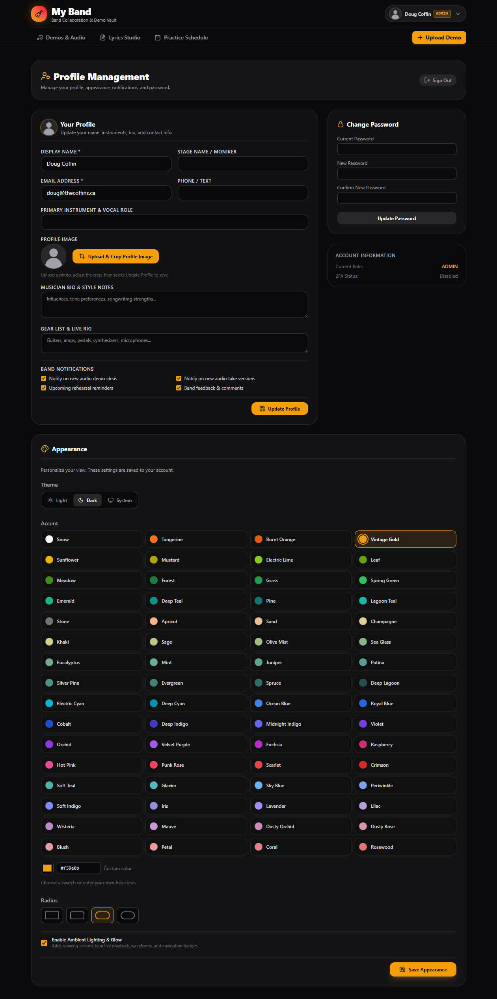

<div align="center">
  
  <h1>BandApp</h1>
</div>

**A shared workspace for bands to manage audio recordings, lyrics, rehearsals, and members.**

BandApp provides a centralized, self-hosted environment for band collaboration, with role-based permissions, secure authentication, audio storage, and customizable user profiles.

## Features


- **Audio Management** - Upload, organize, and access recordings through an authenticated API.
- **Lyrics & Rehearsals** - Collaborate on lyrics and manage rehearsal activities.
- **Member Management** - Manage accounts, permissions, and invitations.
- **Role-Based Access** - Admin, Editor, Member, and Guest permissions enforced by the Express API.
- **Personalized Appearance** - Individual theme, accent color, corner radius, and glow preferences.
- **Email Notifications** - SMTP invitations, delivery tracking, and resend capabilities.
- **Persistent Storage** - SQLite database and audio files stored in separate host bind mounts.
- **Docker Deployment** - Prebuilt production image with persistent bind mounts, health checks, and resource limits.

### Appearance & Branding

Each member can customize their appearance under **Profile & Settings → Appearance**.



Existing accounts inherit the previous shared appearance settings once during an upgrade.

Band-wide branding, including the logo, logo shape, name, and subtitle—is managed exclusively by Admins under **App Settings**.


---

## Getting Started

### Requirements

- Docker Engine with Docker Compose
- Linux container support (AMD64 or ARM64)

### 1. Pull the published image

```bash
docker pull ghcr.io/dcoffin88/bandapp:latest
```

The `latest` tag tracks stable releases. For predictable deployments, you can instead pin a specific published version tag.

### 2. Configure environment variables

Create a `.env` file in your deployment directory:

```dotenv
APP_SECRET=replace-with-a-secure-random-secret
INITIAL_ADMIN_EMAIL=admin@example.com
INITIAL_ADMIN_PASSWORD=replace-with-a-unique-password-of-at-least-12-characters
APP_URL=http://localhost:3000
APP_PORT=3000
TRUST_PROXY_HOPS=0
MAX_UPLOAD_MB=100
PUID=1000
PGID=1000
```

Generate an application secret with:

```bash
openssl rand -hex 32
```

Replace `APP_SECRET` with the generated value, configure your initial Admin account, and set `APP_URL` to the **exact origin** users will visit. Use an HTTPS URL for a production deployment behind a reverse proxy.

On your Linux Docker host, run `id` to see your user and group information:

```bash
id
id -u
id -g
```

Put the numeric results of `id -u` and `id -g` into `PUID` and `PGID` in `.env`, respectively. For example, if both commands return `1000`, use `PUID=1000` and `PGID=1000`. Compose uses these values in its `user:` setting so the container process runs with those host IDs. These values are **Compose variables**, not a guarantee that the image reads `PUID` or `PGID` environment variables internally.

Create the host directories before starting the container:

```bash
mkdir -p ./data ./media
```

Ensure both directories are writable by the selected UID/GID. If their ownership needs correcting, an administrator can run `sudo chown -R "$(id -u):$(id -g)" ./data ./media` after checking that these are the intended directories. Avoid pointing the bind mounts at existing directories whose contents you do not intend to use.

| Variable | Description |
|---|---|
| `APP_SECRET` | Random secret; preserve it across container updates and restores |
| `INITIAL_ADMIN_EMAIL` | Email for the first Admin account; only used for initial database provisioning |
| `INITIAL_ADMIN_PASSWORD` | Unique initial Admin password, at least 12 characters; only used for provisioning |
| `APP_URL` | Exact public origin, including scheme and hostname |
| `TRUST_PROXY_HOPS` | Set to `1` when behind exactly one trusted reverse proxy |
| `MAX_UPLOAD_MB` | Maximum audio upload size in MB, from `1` to `500`; defaults to `100` |
| `APP_PORT` | Host port for BandApp, defaults to `3000`; leave container port at `3000` |
| `PUID` | Numeric host user ID (`id -u`) used by the Compose `user:` setting |
| `PGID` | Numeric host group ID (`id -g`) used by the Compose `user:` setting |

### 3. Create a Docker Compose deployment file

Save the following as `compose.deploy.yaml` in the same directory as `.env`:

```yaml
services:
  app:
    image: ghcr.io/dcoffin88/bandapp:latest
    user: "${PUID}:${PGID}"
    init: true
    env_file:
      - .env
    ports:
      - "${APP_PORT:-3000}:3000"
    volumes:
      - ./data:/app/data
      - ./media:/media
    healthcheck:
      test:
        - CMD
        - node
        - -e
        - "fetch('http://127.0.0.1:3000/api/health').then(r => process.exit(r.ok ? 0 : 1)).catch(() => process.exit(1))"
      interval: 30s
      timeout: 5s
      retries: 3
      start_period: 30s
    restart: unless-stopped
    read_only: true
    tmpfs:
      - /tmp:rw,noexec,nosuid,size=32m
    cap_drop:
      - ALL
    security_opt:
      - no-new-privileges:true
    pids_limit: 128
    mem_limit: 768m
    stop_grace_period: 20s
    logging:
      driver: json-file
      options:
        max-size: "10m"
        max-file: "3"
```

The default port mapping `${APP_PORT:-3000}:3000` publishes BandApp on host port `3000` on all host interfaces. If that port is already in use, set `APP_PORT=3001` in `.env` (equivalent to changing only the first number to `3001:3000`). Then open `http://localhost:3001` and update `APP_URL` to match the actual public origin. The container port must remain `3000`. For an HTTPS reverse-proxy deployment, restrict network access to the application port using firewall rules or a loopback-only binding such as `"127.0.0.1:3000:3000"` when the proxy runs on the Docker host.

### 4. Start BandApp

```bash
docker compose -f compose.deploy.yaml config --quiet
docker compose -f compose.deploy.yaml up -d --no-build --wait
docker compose -f compose.deploy.yaml logs --tail=100 -f app
```

By default, open **http://localhost:3000** and sign in with the initial Admin credentials in `.env`.

When the Admin account has been created, remove `INITIAL_ADMIN_EMAIL` and `INITIAL_ADMIN_PASSWORD` from `.env` and recreate the container:

```bash
docker compose -f compose.deploy.yaml up -d --force-recreate --no-build
```

Changing those initial values later will **not** reset an existing Admin password. Keep `APP_SECRET` unchanged; it is required to decrypt stored SMTP credentials.

### 5. Invite Members

Admins can create accounts through **User Management**.


When a member is created:

1. BandApp sends an invitation using the saved SMTP configuration.
2. The delivery result is recorded in the **Email Settings** outbox.
3. Admins can use **Resend invite** to retry delivery without creating another account.
4. Initial passwords must be communicated separately through a private channel.

Passwords are never included in invitation emails or email logs.

Members can change their passwords under **Profile Management**.

**Account security notes:**

- Public registration is disabled.
- Account impersonation is unavailable.
- Initial Admin environment variables only provision a new database.
- Changing the initial Admin password in `.env` does not reset an existing password.

---

## Production Deployment

For production environments, deploy BandApp behind an HTTPS reverse proxy.

### Reverse Proxy Configuration

Set the production origin in `.env`:

```dotenv
APP_URL=https://band.example.com
TRUST_PROXY_HOPS=1
```

`TRUST_PROXY_HOPS=1` assumes exactly one trusted reverse proxy.

Configure your reverse proxy to:

- Forward requests to port `3000`.
- Keep the application port inaccessible from the public internet.
- Match its request body size limit to `MAX_UPLOAD_MB`.
- Allow upload requests up to 120 seconds.
- Provide valid HTTPS certificates.

HTTPS is required for Secure session cookies and remote microphone recording.

The example Compose mapping exposes port `3000` on host interfaces. Restrict access with a firewall or use `127.0.0.1:3000:3000` for a reverse proxy on the host. If the proxy runs in another container, place both services on a shared Docker network and forward traffic to `app:3000`.

### Container Security

The published Docker image is built using a multi-stage build. The deployment example runs the process as the configured host UID/GID and provides a read-only root filesystem, writable data/media bind mounts, a temporary filesystem, restart behavior, rotated logs, and graceful shutdown.

The Vite development server is not used in production.

For additional information, see [Docker's multi-stage build documentation](https://docs.docker.com/build/building/multi-stage/).

---

## Data Storage

BandApp separates database storage from uploaded audio files.

### Database

The `./data` host directory is bind-mounted at `/app/data` and stores the SQLite database at:

```text
/app/data/bandapp.sqlite
```

The database contains band data, audio metadata, password hashes, user preferences, and sessions.

### Audio Files

Uploaded audio is stored in the `./media` host directory, bind-mounted at `/media`.

Directory structure:

```text
/media/<userName>/<category>/<unique-file-id>.<extension>
```

Example:

```text
/media/Jordan_Smith/riff/12345678-1234-4234-8234-123456789abc.wav
```

**Storage behavior:**

- `userName` is derived from the uploader's display name at upload time.
- Spaces and unsafe folder characters are replaced with underscores.
- Existing directories remain unchanged when a member changes their display name.
- Unique file IDs prevent filename collisions.
- Audio is served through the authenticated API, not a public static directory.

Supported categories:

`idea`, `chorus`, `riff`, `bass`, `full`, `verse`, `bridge`

### Custom Media Directory

To use an existing host media directory, replace `./media:/media` in the Compose file with an absolute bind mount such as `/srv/bandapp/media:/media`. The database mount `./data:/app/data` can be changed similarly.

Ensure the host directories are writable by the UID/GID configured in `.env` (`PUID` and `PGID`). The `MEDIA_MOUNT` variable applies to the repository's original Compose configuration, not this standalone deployment file.

For local npm development, `MEDIA_DIR` defaults to:

```text
./media
```

### SQLite Deployment Limitations

This deployment is designed for:

- A single application container
- Local host bind-mounted storage

Running multiple application replicas or placing the SQLite database on a network filesystem is not supported.

---

## Backup & Restore

**Always back up both the SQLite database and uploaded media.**

Database-only backups do not include audio recordings.

Stop application writes during snapshots and use a separate backup directory for each backup.

### Create a Backup

Stop the application:

```bash
docker compose -f compose.deploy.yaml stop app
```

Create a consistent SQLite backup:

```bash
docker compose -f compose.deploy.yaml run --rm --no-deps app node scripts/backup.mjs /app/data/backups/bandapp.sqlite
```

Copy the database backup to the host:

```bash
docker compose -f compose.deploy.yaml cp app:/app/data/backups/bandapp.sqlite ./bandapp-backup.sqlite
```

Copy uploaded audio:

```bash
docker compose -f compose.deploy.yaml cp app:/media/. ./bandapp-media-backup
```

Restart BandApp:

```bash
docker compose -f compose.deploy.yaml start app
```

### Restore a Backup

Place the matching backup files in the project directory:

```text
bandapp-backup.sqlite
bandapp-media-backup/
```

Stop the application:

```bash
docker compose -f compose.deploy.yaml stop app
```

**Warning:** Restoring the database overwrites the current database. Confirm you have the correct backup before proceeding.

Restore the SQLite database:

```bash
docker compose -f compose.deploy.yaml run --rm --no-deps \
  -v "${PWD}/bandapp-backup.sqlite:/backup.sqlite:ro" \
  app node -e "const fs=require('node:fs'); fs.copyFileSync('/backup.sqlite','/app/data/bandapp.sqlite'); for(const suffix of ['-wal','-shm']) fs.rmSync('/app/data/bandapp.sqlite'+suffix,{force:true})"
```

Restore uploaded media:

```bash
docker compose -f compose.deploy.yaml run --rm --no-deps \
  -v "${PWD}/bandapp-media-backup:/media-backup:ro" \
  app node -e "require('node:fs').cpSync('/media-backup','/media',{recursive:true})"
```

Start the application:

```bash
docker compose -f compose.deploy.yaml start app
```

### Backup Security & Compatibility

- Preserve `APP_SECRET` separately in a secrets manager. It is required to decrypt stored SMTP credentials after restoration.
- Protect backups because they contain private band data and password hashes.
- Configure automated backup retention outside this Compose project.
- Restore backups using the same application release that created them.
- Verify sign-in and audio playback after every restoration.

### Updating BandApp

Back up the database and media before updating. Then pull the latest published image and recreate the application container:

```bash
docker pull ghcr.io/dcoffin88/bandapp:latest
docker compose -f compose.deploy.yaml up -d --no-build --force-recreate --wait
```

Your bind-mounted `./data` and `./media` directories are preserved. To deploy a specific version, update the `image:` tag in `compose.deploy.yaml`, pull that tag, and recreate the service.

---

## Email & Authentication

### SMTP Configuration

SMTP is managed through the application's Admin settings.

Features include:

- Server-side encryption of SMTP passwords using `APP_SECRET`
- Password omission from API responses
- Preservation of saved credentials when the password field is left blank
- Admin-only SMTP connection testing and invitation resends
- TLS certificate validation
- Shared outbox with delivery results and failures

Notifications are attempted after the underlying action succeeds.

Email delivery is best effort. BandApp does not currently provide a durable background email job queue or timed reminder scheduler.

### Authentication & Security

BandApp uses:

- Salted scrypt password hashes
- Opaque HttpOnly/SameSite session cookies
- Account lockout protection
- Request rate limiting
- Request origin validation
- Server-enforced role permissions
- Session revocation following password changes

Session lifetimes are absolute durations measured from sign-in.

Suspended users are denied API access.

Changes made from other devices are refreshed every 15 seconds or when the browser window regains focus.

**Planned Features:**

- Google authentication
- TOTP / two-factor authentication (2FA)

The 2FA settings control is disabled until the feature is implemented.

---

## Local Development

### Requirements

Use Node.js **24.13 or newer**, within the Node 24 release line.

For local development from a source checkout, configure `.env` using the repository’s `.env.example` and the environment guidance in [Getting Started](#getting-started).

Install dependencies:

```bash
npm ci
```

Start the development server:

```bash
npm run dev
```

### Quality Checks

Run the available project checks:

```bash
npm run lint
npm test
npm run build
```

### Production Server (Without Docker)

Build the application, set `NODE_ENV=production`, then start the compiled server:

```bash
npm run build
npm start
```

### Local Backups

Run:

```bash
npm run backup
```

This creates a database-only backup.

For a complete snapshot, stop the application and separately copy the directory configured by `MEDIA_DIR`.

**Note:** Node 24's built-in SQLite API currently emits an experimental-feature warning.

---

## Contributing

Contributions are welcome.

Before contributing, review:

- [Contributing Guidelines](CONTRIBUTING.md)
- [Contributor License Agreement](CLA.md)
- [GPL-3.0 License](LICENSE)

### Branching Strategy

- `dev` — Active development and incoming contributions
- `main` — Tested, release-ready code

Contributions should target `dev`. Tested changes are merged into `main` before a release.

### Continuous Integration

GitHub Actions validates both branches using Node 24.

CI includes:

- TypeScript checks
- ESLint checks for JavaScript tooling
- Automated tests
- Production application build
- Production dependency audit
- Docker image build

---

## Releases

Releases are created from a stable `main` checkout with dependencies installed.

### Release steps for forks

Use Bash (or Git Bash on Windows). The multiline backup and restore commands above also use Bash syntax.

#### 1. Verify Release Readiness

```bash
bash scripts/release.sh --check 1.0.0
```

This performs preflight checks without modifying the repository.

#### 2. Create a Release

```bash
bash scripts/release.sh 1.0.0
```

The release script:

1. Runs application checks.
2. Updates both package manifests.
3. Creates a local release commit.
4. Creates an annotated version tag.

Review the generated commit and tag before pushing.

Use the command printed by the release script to push them atomically.

**Note:** `1.0.0` is an example. Replace it with the intended release version.

### Container Publishing

A version tag pointing to a commit in `main` triggers CI and publishes the application image to:

```text
ghcr.io/dcoffin88/bandapp
```

Supported architectures:

- Linux AMD64
- Linux ARM64

Stable releases receive:

- Full version tags
- Major/minor version tags
- `latest`

Prereleases do not update the `latest` tag.

GitHub Actions must be enabled and have permission to publish packages.

The release workflow does not automatically create a GitHub Release entry.

---

## License

BandApp is open-source software licensed under the [GNU General Public License v3.0](LICENSE).
